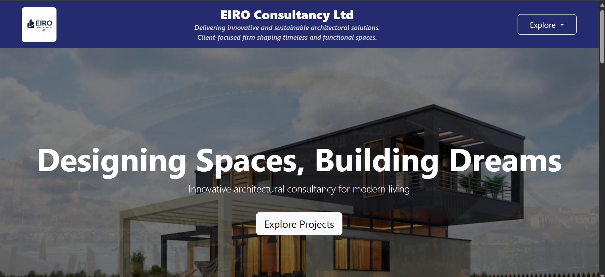
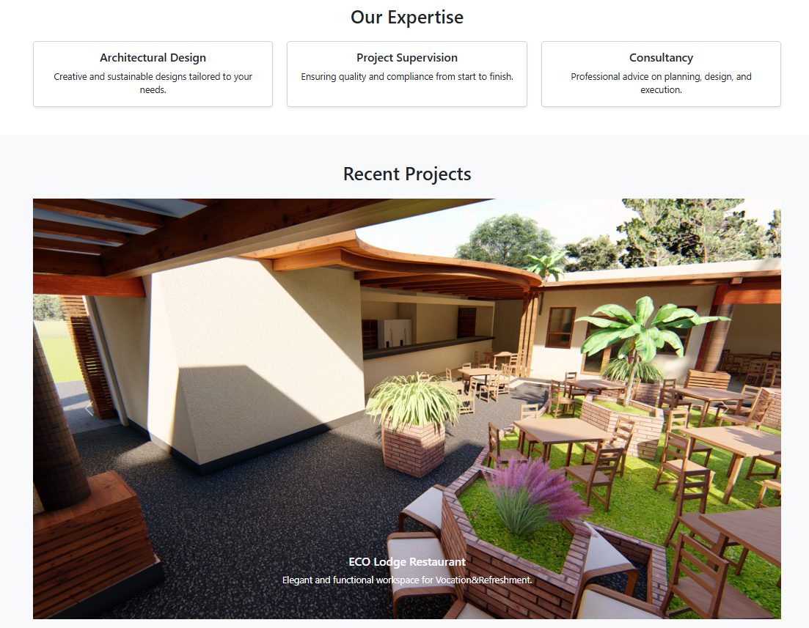
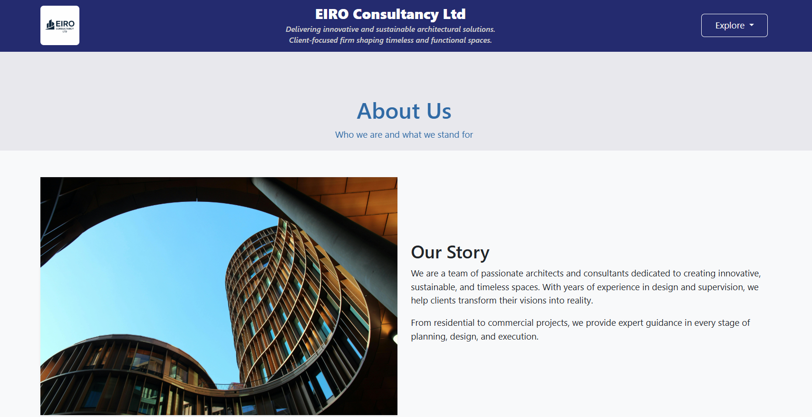
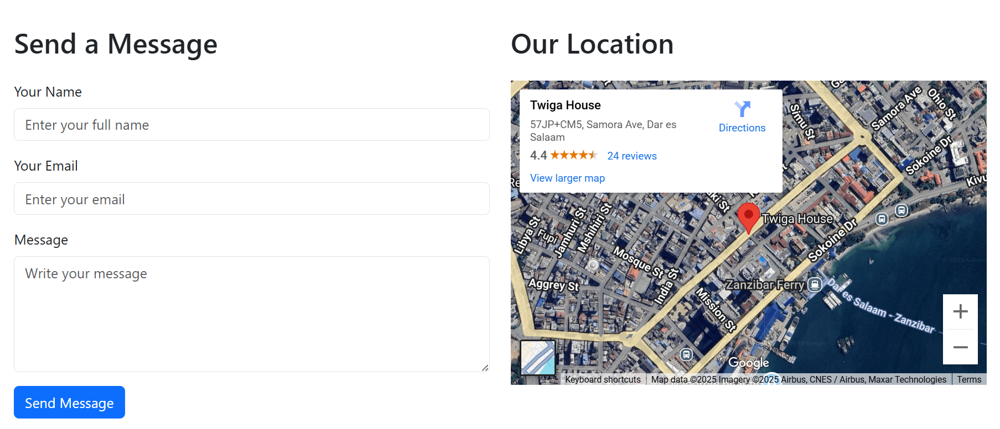
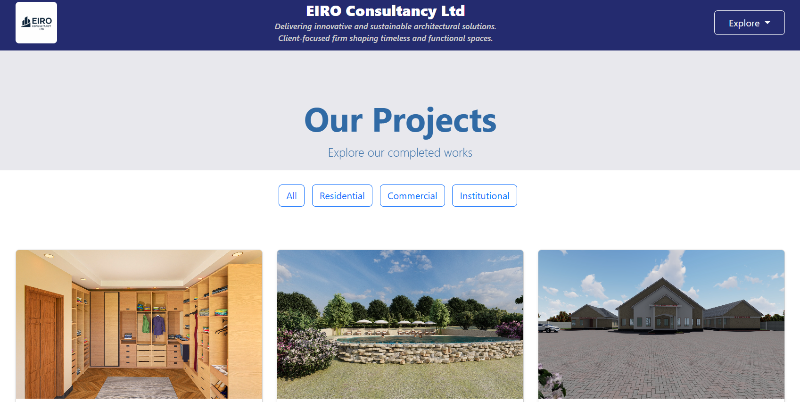
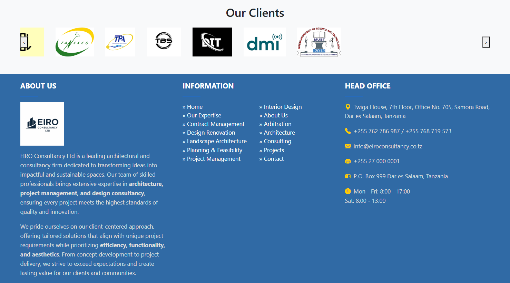
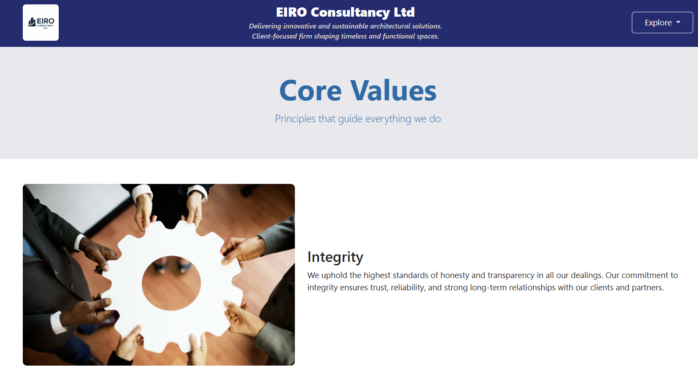
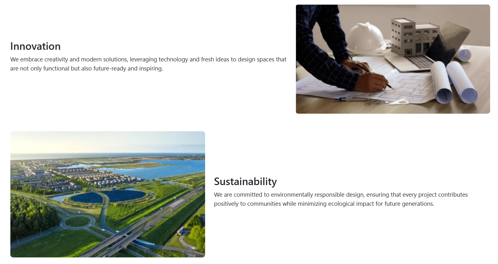

#  EIRO Consultancy Ltd Website

This is the official website for **EIRO Consultancy Ltd**, a premier architectural and engineering consultancy firm in Tanzania.  
The site showcases our company profile, services, expertise, and completed projects.

---

##  Project Structure

project-root/
│
├── html/
│ ├── home.html
│ ├── our_company/
│ │ └── company.html
│ ├── services/
│ │ ├── services.html
│ │ └── (other service pages...)
│ └── expertise.html
│
├── assets/
│ ├── css/
│ │ └── style.css
│ ├── images/
│ │ └── (logo, projects, etc.)
│ └── js/
│ └── script.js
│
└── README.md


---

##  Getting Started

Follow the steps below to view or contribute to this project.

# Clone the Repository

```bash
git clone https://github.com/emmajulius/eiro-consultancy.git
2️ Navigate to Project Directory
bash
Copy code
cd eiro-consultancy-website
3️ Open in Browser
You can open the website by double-clicking the html/home.html file or serve it locally:

bash
Copy code
# Using Python
python -m http.server
Then visit: http://localhost:8000/html/home.html


 Technologies Used
HTML5

CSS3 (Bootstrap 5)

JavaScript (Vanilla)

 Features
Responsive design (desktop & mobile friendly)

Interactive navigation menu

 License
This project is NOT ALLOWED to be copied or Reused by any means, EIRO Consultancy 2025. All Rights Reserved.


## 🖼️ Screenshots

### Homepage



### Services Page


### Company Profile



## Projects


## Footer


## Expertise


### Core Values


